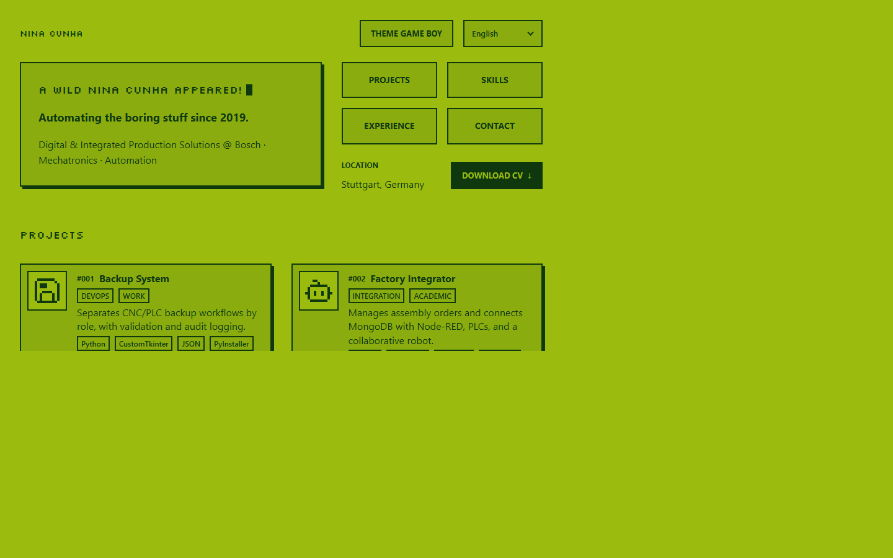

# Nina Cunha · Portfolio

A personal portfolio of Nina Cunha's CNC programming, automation, and Industry 4.0 work, presented in a Game Boy-inspired pixel design.

[](https://cunhadev.vercel.app)

**Live:** https://cunhadev.vercel.app

## Highlights

- Choose between the Game Boy and Ink themes.
- Read the portfolio in English, Portuguese, or German.
- Typed projects, skills, and timeline entries live in `src/data/`; add each by editing one object.
- Keyboard focus styles, a skip link, and Escape-to-close dialogs; reduced-motion preferences are respected.

## Getting started

```bash
git clone https://github.com/cunhanina/portfolio.git
cd portfolio
npm install
npm run dev
```

Requires Node.js `18.20.8 || ^20.3.0 || >=22.0.0`. The dev server runs at the address Astro prints.

## Commands

| Script         | Purpose                                     |
| -------------- | ------------------------------------------- |
| `dev`          | Start the Astro development server.         |
| `build`        | Build the static site into `dist/`.         |
| `preview`      | Preview the production build locally.       |
| `check`        | Run Astro and TypeScript checks.            |
| `lint`         | Lint with ESLint.                           |
| `format`       | Format source and root JSON, Markdown, MJS. |
| `format:check` | Check formatting without writing.           |
| `verify`       | Run checks, then build.                     |

## Structure

```text
src/
  assets/      Source assets
    project-icons/ Project SVGs and license
  components/  Astro UI components
  data/        Typed portfolio records
  i18n/        English, Portuguese, German dictionaries
  pages/       Page routes and metadata
  scripts/     Browser behavior
  styles/      Global CSS and design tokens
  types/       Shared TypeScript types
```

`public/` contains static assets, including the CV.

## Editing content

<details><summary>How to edit projects, skills, experience and more</summary>

To remove an item, delete its object; to add one, copy the example; to reorder, move it. Keep translation keys in all three locales.

### Projects

Projects are in `src/data/projects.ts` (`Project`):

```ts
{
  order: 1, title: 'Backup System', type: 'DEVOPS', context: 'WORK',
  repo: repoUrls.backupsys,
  outcome: 'Separates CNC/PLC backup workflows by role, with validation and audit logging.',
  description: 'A Python desktop application with separate operator and engineering interfaces for CNC/PLC backup tasks. It validates data and records actions in an audit trail.',
  icon: 'backupsys', tech: ['Python', 'CustomTkinter', 'JSON', 'PyInstaller']
}
```

Project copy uses `project.<order>.{title,type,outcome,description}` in `src/i18n/en.ts`, `src/i18n/pt.ts`, and `src/i18n/de.ts`; icons are in `src/assets/project-icons/`. Side quests in `src/data/projects.ts` use `name`, `summary`, `repo`, and optional `demo`.

### Skills

Skills are in `src/data/skills.ts` (`SkillGroup`):

```ts
{
  category: 'MANUFACTURING',
  skills: [{ label: 'CNC Programming', evidence: [{ label: 'CNC programming role',
    translationKey: 'skills.evidence.cncRole', href: '#experience-entry-1' }] }]
}
```

Skills use `label` and optional evidence (`label`, `translationKey`, `href`, `external`, `showLink`); `showLink: false` hides that evidence link. `skillsPitch` uses `skills.pitch`.

### Experience

Experience is in `src/data/experience.ts` (`ExperienceEntry`):

```ts
{
  id: 'experience-entry-2', title: 'experience.role.apprentice', company: 'Bosch',
  date: { start: '2023-07', end: '2025-07' },
  location: 'experience.role.apprentice.location',
  bullets: ['experience.role.apprentice.bullet.0'],
  highlights: [{ label: 'experience.leadership', note: 'experience.leadership.date',
    bullets: ['experience.leadership.bullet.0'] }]
}
```

Dates use `YYYY-MM` (`end: null` means current). `company` is an optional plain-text field, rendered with an `@` prefix (for example, `@ Bosch`); `highlights` contain translated `label`, `note`, and `bullets`.

### Education

Education is in `src/data/education.ts` (`EducationEntry`):

```ts
{
  id: 'education-0', title: 'education.0.program',
  chip: { label: 'experience.education.inProgress', variant: 'progress' },
  date: { start: '2024-03', end: '2028-12' },
  subtitle: 'education.0.institution', meta: 'education.0.qualification'
}
```

Education uses shared timeline fields, without `company` or `highlights`.

### Contact

Contact links are in `src/data/contact.ts` (`ContactLink`):

```ts
{
  label: 'EMAIL',
  translationKey: 'contact.label.email',
  href: 'mailto:you@example.com', external: false
}
```

Shared profile metadata and the CV path are in `src/data/profile.ts`.

### Translations and adding a language

Translations live in `src/i18n/en.ts`, `src/i18n/pt.ts`, and `src/i18n/de.ts`; English defines the `TranslationKey` set. To add a language, extend `Language` in `src/types/i18n.ts`, add a complete dictionary in `src/i18n/`, and register it in `src/i18n/index.ts`. Add its option in `src/components/Hero.astro`, include it in `src/scripts/localization.ts` and `src/scripts/timeline-dates.ts`, and update the stored-language bootstrap in `src/pages/index.astro`.

Adding a language currently touches several files (see above); centralizing the language list is a possible future cleanup.

</details>

## Credits

- Project icons: [Pixelarticons](https://github.com/halfmage/pixelarticons), [MIT License](https://opensource.org/license/mit/). Copyright (c) 2019 Gerrit Halfmann. [License text](src/assets/project-icons/LICENSE).
- Pixel font: [Silkscreen](https://github.com/googlefonts/silkscreen), [SIL Open Font License 1.1](https://openfontlicense.org/open-font-license-official-text/). Copyright 2001 The Silkscreen Project Authors (https://github.com/googlefonts/silkscreen).

## License

© Nina Cunha. All rights reserved. The source is public for reference; please do not copy the site, its design or its content.
